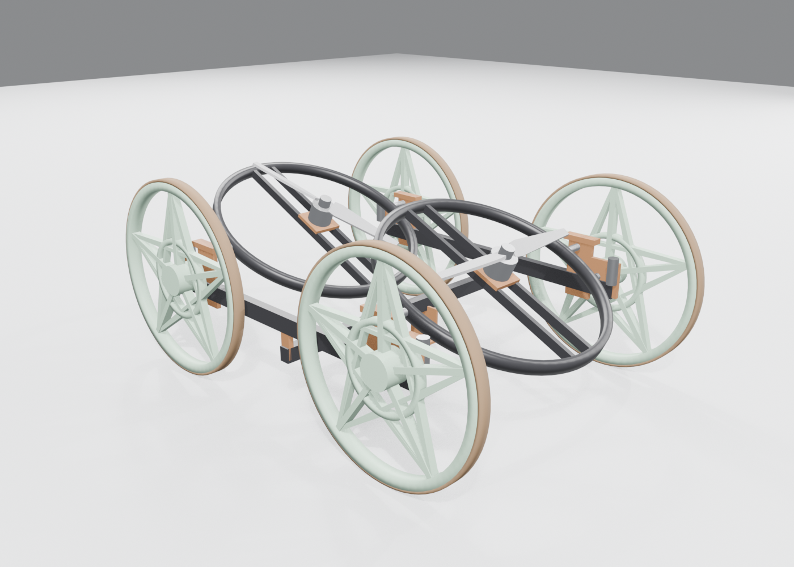

# Design files

Body of the climber: star-spoke wheels, propeller hoops, H-frame. Electronics are drawn in the full model (below) and counted in the
weight numbers and in the clearance check. Printing: [docs/PRINTING.md](../docs/PRINTING.md). Build steps: [docs/PLAN.md](../docs/PLAN.md).



| File | What |
|---|---|
| `blender/build_robot.py` | The source of truth. Builds every part, checks it, exports everything below |
| `print/*.stl` | 7 printable parts, in mm, already lying flat for the slicer |
| `PARTS_REPORT.md` | Grams per part at each infill, print settings and time, weight by group (generated) |
| `mass_properties.json` | Weights + centres of mass; `sim/climb.py` reads it (generated) |
| `assets/wall_climber_body.blend` / `.glb` | Assembled model |
| `assets/robot_preview.png` | Render |
| `blender/animate_robot.py` | Adds the bought parts (servos, motors, battery, ESCs, boards, bearings) and the climb animation |
| `assets/wall_climber_full.blend` / `.glb` / `.stl` | Whole robot with every part. The .blend and .glb are animated (16 s climb from the sim); the .stl is one static mesh |
| `assets/climb_preview.mp4` | Quick render of that animation |

Rebuild from the repo root (Blender 4.2+, takes ~2 min):

```bash
blender -b --factory-startup -P design/blender/build_robot.py
```

It prints one line per printed part (`bad_edges=0` means a clean, watertight solid the slicer will accept),
then `CLEARANCE OK` and the total weight. The script also:
- builds every printed part from boxes and cylinders with exact booleans (no hand-modelled meshes)
- sweeps both hoops (with clips, motor, prop and roll servo) through their servo range against the frame, wheels and
  the space the electronics take. `CLEARANCE FAIL` names what hits what
- computes printed grams from the real solid volume: walls are solid, the inside is filled at the chosen infill

Full model + animation (after the build above):

```bash
python sim/climb.py --record   # saves sim/climb_anim.json
blender -b design/assets/wall_climber_body.blend --factory-startup -P design/blender/animate_robot.py -- --preview
```

Changing something:
- A dimension: edit the KEY DIMENSIONS block at the top, then the same number in `sim/wall_climber.xml`.
- A bought part's weight: edit `HW_CHASSIS` / `HW_HOOP` / `HW_WHEEL` (weigh the real part).
- Walls or infill: edit `PRINTED`.

Then rebuild, and run `python sim/climb.py --min-thrust` to see what thrust the robot now needs.
