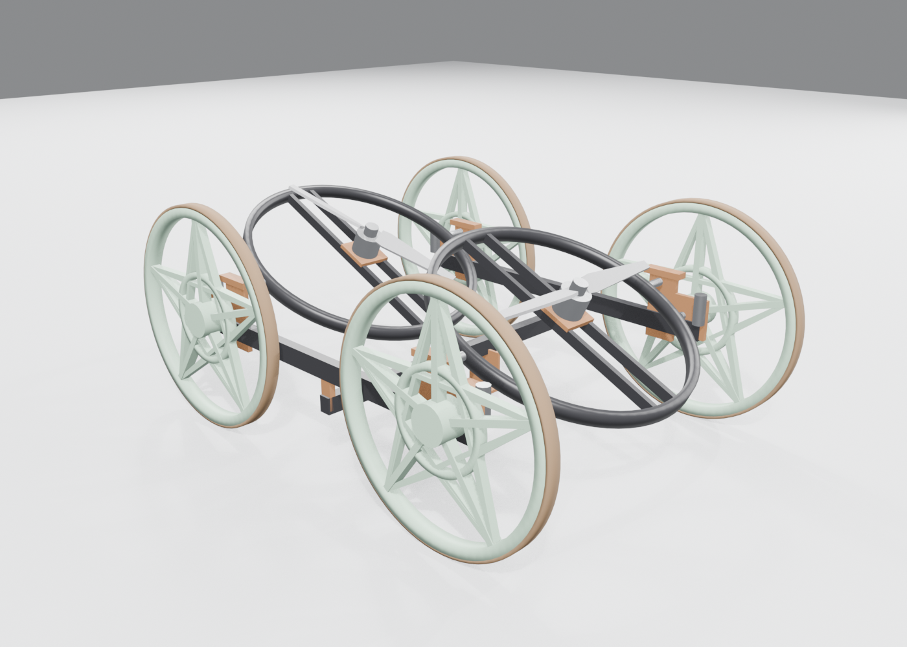

# Robot specs

Build guide: [BUILD.md](BUILD.md). Step-by-step checklist: [SETUP.md](SETUP.md).
Every printed part at each infill: [design/PARTS_REPORT.md](../design/PARTS_REPORT.md).

## How it climbs

Two propellers sit in tilting hoops. A servo tilts each hoop, so the prop can push forward (to drive on the floor),
up (to lift the nose onto the wall) or into the wall and up (to stick and climb). The 4 wheels have no motors:
they just roll. An ESP32 reads the tilt from an MPU6050 and sets each hoop's angle and thrust.

## Main specs

| | Value |
|---|---|
| Weight (as designed) | 1,039 g: 330 g printed + ~710 g bought parts |
| Weight limit | <= 1,050 g as built |
| Size (L x W x H) | 546 x 364 x 216 mm with the hoops flat (up to ~270 mm tall with a hoop upright) |
| Wheelbase x track | 330 x 350 mm |
| Wheels | 4 passive star-spoke wheels, Ø216 mm with tire, 2 x 624ZZ each |
| Ground clearance | 50 mm |
| Centre of mass | 109 mm above the surface |
| Propulsion | 2 x A2212 1400KV + 9045 props (one CW, one CCW), 2 x 30 A ESC |
| Thrust needed | 1,245 gf total just to hang on the wall; 721 gf per motor minimum to climb (sim) |
| Thrust-test pass mark | >= 750 g per motor, aim for 800 |
| Thrust-vector range | front hoop -4° ... 140°, rear hoop -40° ... 140° (MG90S through 1:1 gears) |
| Climb speed | 0.18 m/s (sim: floor -> 1.75 m in about 11 s) |
| Battery | 3S 11.1 V 1500 mAh LiPo, XT60 |
| Run time on the wall | about 3-4 min per charge (estimate: about 10 A per motor while holding; measure yours) |
| Controller | ESP32 DevKit V1, MPU6050 IMU, front limit-switch bumper, battery voltage divider |
| Control link | Wi-Fi from the ESP32 (AP `WallBot`), phone or laptop web UI. No RC radio |
| Power for logic + servos | XL4015 buck, 5.0 V |
| Wall surface | flat and smooth (painted wall, whiteboard, plywood). The wheels need grip: μ >= 0.6 |
| Cost | ₱5,155 (₱4,505 if the school gives the filament) |

## Weight of every part

Printed parts (PLA+, 0.4 mm nozzle, 0.2 mm layers, 4 top / 4 bottom layers). Why each infill: [BUILD.md §4](BUILD.md).

| Part | Qty | Walls | Infill | g each | g total |
|---|---|---|---|---|---|
| Wheel | 4 | 2 | 20% gyroid | 52.3 | 209.2 |
| Corner bracket (2 + 2 mirrored) | 4 | 3 | 40% gyroid | 16.1 | 64.6 |
| Gear 24T | 4 | 4 | 100% | 3.0 | 12.0 |
| Motor mount | 2 | 3 | 50% gyroid | 6.6 | 13.1 |
| Hoop clip | 4 | 3 | 50% gyroid | 3.6 | 14.3 |
| Battery tray | 1 | 2 | 15% gyroid | 13.2 | 13.2 |
| Bumper arm | 1 | 2 | 20% gyroid | 3.6 | 3.6 |
| Printed total | | | | | 330 |

Bought parts (typical listing weights; weigh yours and update `HW_*` in `design/blender/build_robot.py`):

| Part | Qty | g each | g total |
|---|---|---|---|
| 3S 1500 mAh LiPo | 1 | 125 | 125 |
| A2212 1400KV motor + prop adapter | 2 | 50 | 100 |
| 30 A ESC | 2 | 30 | 60 |
| Aluminium rails (2 x 380 mm) + cross beam (284 mm) | 1 | 65 | 65 |
| MG90S servo (2 pitch + 2 roll) | 4 | 13.4 | 54 |
| Embroidery hoop, inner ring | 2 | 38 | 76 |
| 9045 propeller | 2 | 12 | 24 |
| Inner-tube tire strip | 4 | 9 | 36 |
| 624ZZ bearings (2 per wheel) | 8 | 2.9 | 23 |
| XL4015 buck converter | 1 | 18 | 18 |
| ESP32 DevKit + MPU6050 | 1 | 13 | 13 |
| Carbon roll axle 6 x 4 mm, 252 mm | 2 | 6 | 12 |
| Wiring, switch, XT60s | 1 | 37 | 37 |
| Bolts, screws, pins, 693ZZ bearings, zip ties, velcro, limit switch | 1 | 69 | 69 |
| Bought total | | | ~710 |

By assembly group (what the sim uses, from `design/mass_properties.json`):

| Group | g |
|---|---|
| Chassis (frame, brackets, tray, battery, electronics, pitch servos) | 487 |
| Left hoop (hoop, clips, roll axle, motor mount, motor, prop, roll servo, pivot gear) | 144 |
| Right hoop | 141 |
| 4 wheels | 268 |
| Total | 1,039 |

Every 50 g extra needs about 35 gf more thrust per motor. Over 1,050 g the 750 g pass mark
isn't enough any more: rerun `python sim/climb.py --min-thrust`.

## Parts list (one robot)

| # | Part | Pick this | Qty | ₱ |
|---|---|---|---|---|
| 1 | Microcontroller | ESP32 DevKit V1 (30-pin) | 1 | 250 |
| 2 | IMU | MPU6050 (GY-521) | 1 | 120 |
| 3 | Front bumper | Micro limit switch with lever | 1 | 25 |
| 4 | Buck converter | XL4015 5 A step-down | 1 | 120 |
| 5 | Battery | 3S 11.1 V 1500 mAh 25C LiPo, XT60 | 1 | 750 |
| 6 | Charger | B3 2S/3S balance charger | 1 | 220 |
| 7 | LiPo alarm | 1-8S voltage checker / buzzer | 1 | 60 |
| 8 | Power wiring | XT60 pairs x3, 14 AWG silicone wire 1 m, toggle switch | 1 | 180 |
| 9 | Small parts | Dupont wires, perfboard, 100k + 27k resistors | 1 | 80 |
| 10 | Brushless motor | A2212 1400KV with prop adapter | 2 | 500 |
| 11 | ESC | 30 A SimonK / BLHeli | 2 | 520 |
| 12 | Propellers | 9045 CW + CCW pair | 2 | 140 |
| 13 | Servos | MG90S metal gear | 4 | 440 |
| 14 | Prop hoops | 10" wooden embroidery hoop | 2 | 160 |
| 15 | Filament | PLA+ 1 kg (uses ~350 g) | 1 | 650 |
| 16 | Tires | Bicycle inner tube, 10 mm strips | 1 | 50 |
| 17 | Rails + beam | Aluminium square tube 8 x 8 x 0.8 mm, 1.5 m | 1 | 150 |
| 18 | Roll axles | Carbon tube 6 x 4 mm, 0.6 m | 1 | 150 |
| 19 | Bearings | 624ZZ x8, 693ZZ x4 | 1 | 240 |
| 20 | Fasteners | M4x40 bolts + lock nuts x4, M3 kit, M2 servo screws | 1 | 200 |
| 21 | Consumables | Zip ties, foam tape, velcro strap, CA glue | 1 | 150 |
| | Total | | | 5,155 |

Prices are typical Shopee/Lazada prices; check them before ordering. Budget notes are in [BUILD.md §2](BUILD.md).

## Pins (proposal, lead still has to OK it)

| Signal | ESP32 pin |
|---|---|
| ESC front / rear | 25 / 26 |
| Hoop pitch servo front / rear | 18 / 32 |
| Roll servo front / rear | 19 / 33 |
| MPU6050 SDA / SCL | 21 / 22 |
| Bumper switch | 27 |
| Battery voltage (100k / 27k divider) | 34 |
| Status LED | 2 |

Wiring diagram and placement: [BUILD.md §6-7](BUILD.md).

## Tested so far (sim only)

| Check | Tool | Result |
|---|---|---|
| Hoops never hit the frame, wheels or electronics over the full servo range | Blender (`design/blender/build_robot.py`) | CLEARANCE OK |
| Printed parts are watertight and printable | Blender | all 7 parts OK |
| Climbs and holds at 1.75 m, ideal | MuJoCo (`sim/climb.py`) | on the wall 1.8 s, PASS |
| Climbs with battery sag, μ 0.6, +10% weight, servo limits, IMU noise, a pull off the wall | MuJoCo `--real` | on the wall 2.8 s, PASS |
| Same climb in a second physics engine | Webots (`sim/webots/`) | ideal 2.6 s, real 2.9 s, both PASS |
| Smallest thrust per motor that still climbs | MuJoCo `--min-thrust` | 721 gf |

Nothing has been printed or built yet. The numbers to check first on real hardware are the thrust test (>= 750 g per
motor) and the built weight (<= 1,050 g).
